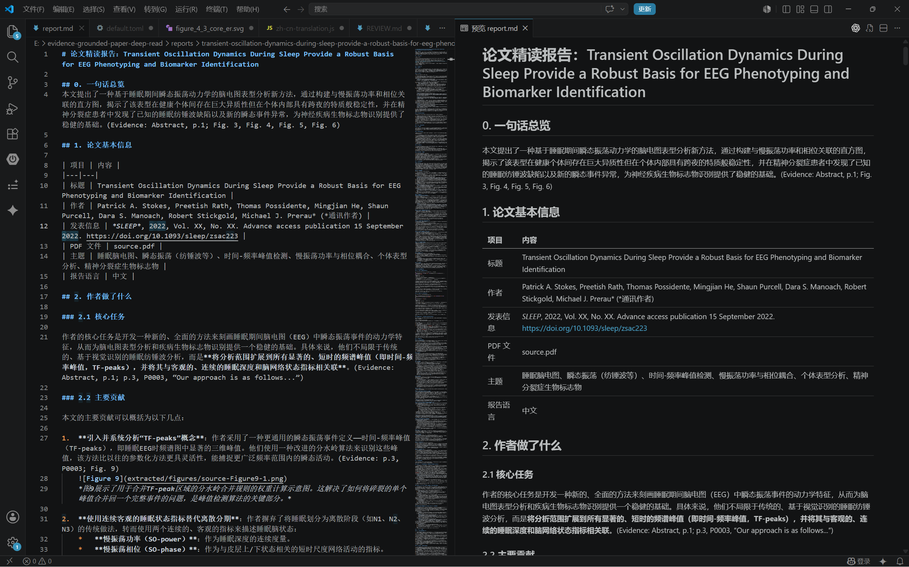
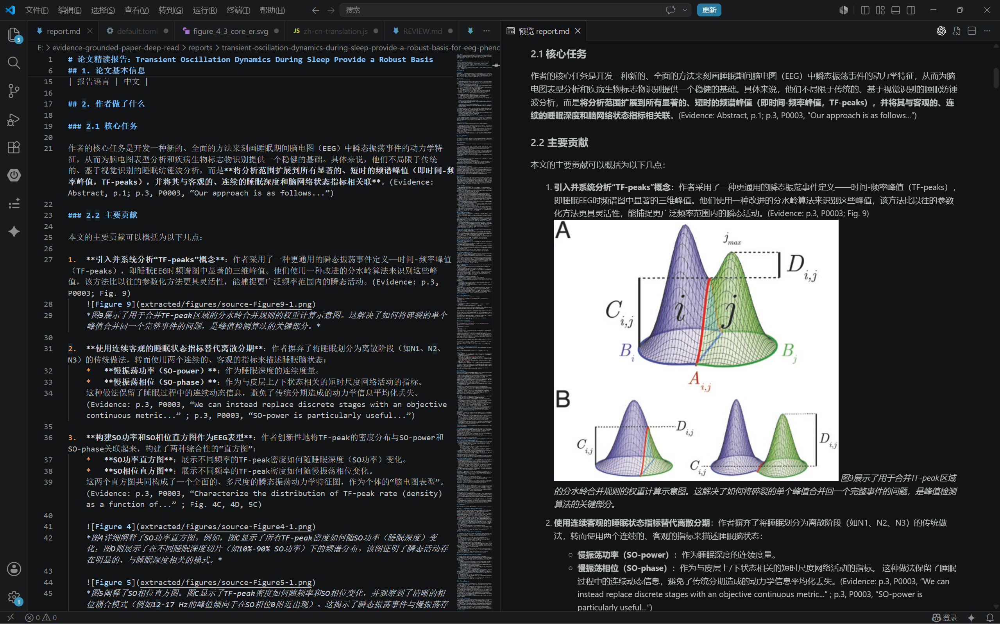
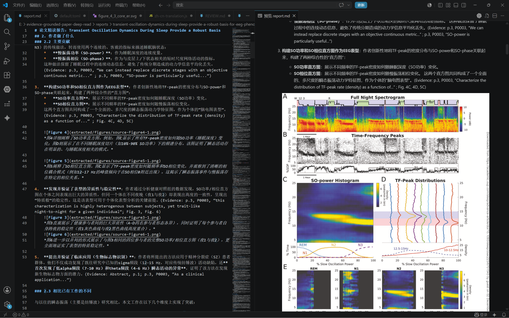

# Evidence-Grounded Paper Deep Read

[English](README.md) | [中文](README.zh-CN.md)

Evidence-Grounded Paper Deep Read is a Codex skill and CLI workflow for turning research PDFs into detailed, evidence-grounded Markdown deep-reading reports.

The project is built for readers who want more than a summary. It asks the model to explain what the authors did, why they did it, how the method works, how the experiments support the claims, and how figures, formulas, tables, metrics, and technical terms connect to the paper.

## Preview

The generated report is Markdown, so it can be read directly in a Markdown editor, committed as research notes, or sent into a document workflow such as Feishu CLI.







## Features

- Generate one Markdown deep-reading report per PDF.
- Use a reusable Codex skill under `skills/evidence-grounded-paper-deep-read/`.
- Extract paper text, section-like paragraph anchors, and figure/table metadata.
- Extract cropped paper figures and tables with [allenai/pdffigures2](https://github.com/allenai/pdffigures2).
- Generate reports with a sectioned workflow instead of one huge prompt.
- Integrate figures into the relevant discussion instead of putting them in a separate figure appendix.
- Validate reports for required sections, evidence markers, image references, and mixed-language heading issues.
- Export the skill prompt for use with another model or agent.

## How It Works

```text
PDF folder
  -> text extraction
  -> pdffigures2 figure/table extraction
  -> paper index and figure manifest
  -> sectioned evidence packs
  -> MiMo OpenAI-compatible chat API
  -> Markdown report
  -> report validator
```

The default `sectioned` generation mode writes the report in stages:

1. Metadata and one-sentence overview.
2. What the authors did and why they did it.
3. Method, formulas, and technical details.
4. Experiments, baselines, metrics, and results.
5. Innovation points, limitations, beginner background, and reproduction notes.
6. Completeness checklist.

This staged design is more robust for papers of different lengths than sending the entire paper as a single prompt.

## Repository Layout

```text
.
├─ paperdeepread/                         # Python CLI package
│  ├─ cli.py                              # CLI commands
│  ├─ pipeline.py                         # PDF-to-report workflow
│  ├─ evidence_pack.py                    # Stage-specific evidence selection
│  ├─ sectioned.py                        # Multi-stage report assembly
│  └─ providers/mimo.py                   # Xiaomi MiMo provider
├─ skills/
│  └─ evidence-grounded-paper-deep-read/  # Reusable Codex skill
│     ├─ SKILL.md
│     ├─ agents/openai.yaml
│     ├─ references/
│     ├─ scripts/
│     └─ assets/report_template.md
├─ scripts/
│  └─ run_pdffigures2.ps1                 # pdffigures2 helper wrapper
├─ workflows/
│  └─ pdffigures2.md                      # pdffigures2 setup and validation notes
├─ images/                                # README screenshots
├─ tests/                                 # Unit tests
├─ .paperdeepread.example.toml            # Example CLI config
├─ requirements.txt
└─ pyproject.toml
```

## Requirements

- Python 3.10+
- Java runtime for `pdffigures2`
- A built `pdffigures2.jar`
- A Xiaomi MiMo API key for the first supported LLM provider

`pdffigures2` is an external project by AllenAI. This project uses it to locate and crop figures/tables from PDF papers. See [workflows/pdffigures2.md](workflows/pdffigures2.md) for local build notes.

## Install

```bash
git clone <your-repo-url>
cd evidence-grounded-paper-deep-read
python -m venv .venv
python -m pip install -r requirements.txt
python -m pip install -e .
```

Activate the virtual environment before installing dependencies.

macOS/Linux:

```bash
source .venv/bin/activate
```

Windows PowerShell:

```powershell
.\.venv\Scripts\Activate.ps1
```

After installation, either command form works:

```bash
python -m paperdeepread --help
paperdeepread --help
```

## Build Or Prepare pdffigures2

Clone or download [allenai/pdffigures2](https://github.com/allenai/pdffigures2), build its jar, and pass the jar path to the CLI.

A typical local layout is:

```text
evidence-grounded-paper-deep-read/
  pdffigures2/
    pdffigures2.jar
```

Local notes:

- JDK 17 worked well in testing.
- Very new JDKs may fail with the older Scala/SBT stack used by `pdffigures2`.
- The CLI accepts any jar path through `--pdffigures2-jar`.

## Configure The LLM Provider

Create a config file:

```bash
python -m paperdeepread init-config
```

The default config uses Xiaomi MiMo:

```toml
[llm]
provider = "mimo"
base_url = "https://token-plan-cn.xiaomimimo.com/v1"
model = "mimo-v2.5-pro"
api_key_env = "MIMO_API_KEY"
temperature = 0.2
max_tokens = 24000
timeout_seconds = 900
stream = true
```

Set the API key in your shell.

macOS/Linux:

```bash
export MIMO_API_KEY="your_key"
```

Windows PowerShell:

```powershell
$env:MIMO_API_KEY="your_key"
```

## Generate Reports

Create a folder for input PDFs:

```text
paper/
  paper-1.pdf
  paper-2.pdf
```

Run the CLI:

```powershell
python -m paperdeepread run `
  --input paper `
  --output reports `
  --config .paperdeepread.toml `
  --pdffigures2-jar .\pdffigures2\pdffigures2.jar `
  --java-path java
```

With a local JDK 17 path on Windows:

```powershell
python -m paperdeepread run `
  --input paper `
  --output reports `
  --config .paperdeepread.toml `
  --pdffigures2-jar .\pdffigures2\pdffigures2.jar `
  --java-path .\.tmp\tools\jdk17\jdk-17.0.19+10\bin\java.exe
```

Each paper gets a workspace like this:

```text
reports/
  paper-slug/
    source.pdf
    report.md
    paper_index.json
    stages/
      overview_metadata.md
      what_why.md
      how_formula.md
      experiment.md
      innovation_limits_background.md
      checklist.md
    extracted/
      full_text.md
      sections.json
      figure_manifest.json
      figures/
        source-Figure1-1.png
```

## Use With Feishu CLI

The final report is standard Markdown. If your research workflow uses Feishu CLI, you can pipe or upload `report.md` through your existing Feishu Markdown import process to create collaborative documents, knowledge-base pages, or reading-note archives.

A common workflow is:

```text
paper PDF -> paperdeepread report.md -> Feishu CLI Markdown import/sync -> shared Feishu document
```

## Use The Skill Directly

The reusable skill lives at:

```text
skills/evidence-grounded-paper-deep-read/
```

Point Codex or another compatible agent at that folder when you want an agent to use the reading protocol without the CLI.

You can also export a combined prompt:

```bash
python -m paperdeepread export-skill-prompt --out skill_prompt.md
```

## Validate A Report

```bash
python skills/evidence-grounded-paper-deep-read/scripts/validate_report.py reports/paper-slug/report.md
```

The validator checks required report sections, Markdown image references, evidence markers, mixed-language headings, full-page preview references, and weak generic wording patterns.

## Run Tests

```bash
python -m unittest discover -s tests -v
```

## License

MIT License. See [LICENSE](LICENSE).
